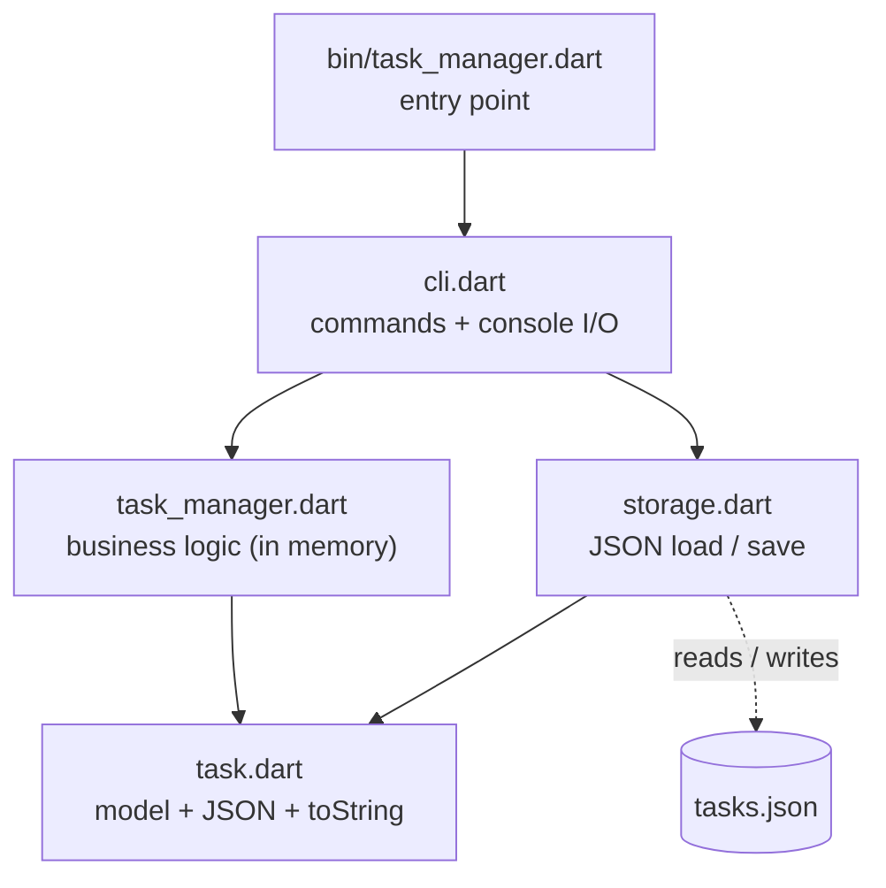

# Task Manager CLI

[](https://dart.dev)
[](LICENSE)

A small, dependency-free command-line task manager written in pure Dart. Add, list, complete, delete, search, filter and group tasks from your terminal, with automatic persistence to a human-readable JSON file.

The project is intentionally compact and built around a strict layered architecture, so each concern (model, business logic, storage, console I/O) lives in exactly one place and can be tested in isolation.

---

## Table of contents

- [Features](#features)
- [Requirements](#requirements)
- [Getting started](#getting-started)
- [Usage](#usage)
- [Command reference](#command-reference)
- [Data file format](#data-file-format)
- [Error handling](#error-handling)
- [Architecture](#architecture)
- [Project structure](#project-structure)
- [Development](#development)
- [Known limitations](#known-limitations)
- [License](#license)

---

## Features

- **Full task lifecycle:** add, list, mark as done, delete.
- **Rich metadata:** optional due date, category (default `general`) and any number of tags per task.
- **Search:** case-insensitive match over titles and descriptions.
- **Filtering:** by status (`--done`, `--pending`) or by tag.
- **Grouping:** view tasks grouped by category.
- **Two run modes:** a single command per invocation, or an interactive prompt.
- **Automatic persistence:** state is saved to `tasks.json` after every command that changes data, and restored on the next run.
- **Resilient storage:** a corrupted data file never crashes the program; it is moved aside to `tasks.json.bak` and the app starts with an empty list.
- **Collision-free IDs:** IDs keep counting from the highest stored ID, so new tasks never reuse an ID that is already in the file.
- **No runtime dependencies:** only the Dart SDK is required (`test` and `lints` are development-only).

## Requirements

- [Dart SDK](https://dart.dev/get-dart) `^3.5.4`

## Getting started

```bash
git clone https://github.com/Ammar-Technology/task_manager.git
cd task_manager
dart pub get
dart run bin/task_manager.dart help
```

Optionally, compile a standalone executable:

```bash
dart compile exe bin/task_manager.dart -o task
./task list
```

> `tasks.json` is read from and written to the **current working directory**, so run the program from the folder where you want your data to live.

## Usage

### One-shot mode

Pass a command as arguments. The program executes it and exits.

```bash
dart run bin/task_manager.dart add "Buy milk" \
  --cat home --tag errands --tag urgent --due 2026-11-10
dart run bin/task_manager.dart list
dart run bin/task_manager.dart done 1
```

### Interactive mode

Run without arguments to get a prompt. Type `exit` (or press `Ctrl+D`) to quit.

```text
$ dart run bin/task_manager.dart
Task Manager. Type "help" for commands, "exit" to quit.
> add Buy milk --cat home --tag urgent
Added: [1] [x] Buy milk #urgent
> add Write report --cat work
Added: [2] [x] Write report
> done 1
Task 1 marked as done.
> list
[1] [✓] Buy milk #urgent
[2] [x] Write report
> exit
```

In interactive mode the line is split on whitespace, so titles do not need quotes. Surrounding quotes, if you type them, are removed.

## Command reference

| Command | Description | Saves? |
|---|---|:---:|
| `add <title> [options]` | Add a task (see [add options](#add-options)). | Yes |
| `list` | Show all tasks, or `No tasks.` | No |
| `done <id>` | Mark a task as done. | Yes |
| `delete <id>` | Delete a task. | Yes |
| `search <text>` | Case-insensitive search in titles and descriptions. Prints `No matches.` when empty. | No |
| `filter <option>` | Filter tasks. Exactly one option is required (see [filter options](#filter-options)). | No |
| `categories` | Show tasks grouped by category. | No |
| `help` | Print the command table. | No |
| `exit` | Quit (interactive mode only). | No |

### add options

| Option | Meaning | Default |
|---|---|---|
| `--due YYYY-MM-DD` | Due date. An unparsable date is rejected. | none |
| `--cat <name>` | Category of the task. | `general` |
| `--tag <name>` | Add a tag. May be repeated. | no tags |

### filter options

| Option | Result |
|---|---|
| `--done` | Completed tasks only |
| `--pending` | Pending tasks only |
| `--tag <name>` | Tasks carrying the tag |

### Output format

Each task prints as:

```text
[<id>] [<status>] <title> #tag1 #tag2
```

`✓` marks a completed task and `x` a pending one.

### Examples

```bash
# Add a task with a category, two tags and a due date
dart run bin/task_manager.dart add "Pay electricity bill" \
  --cat home --tag bills --tag urgent --due 2026-11-10
# Added: [1] [x] Pay electricity bill #bills #urgent

# Search (case-insensitive)
dart run bin/task_manager.dart search ELECTRICITY

# Only pending tasks, or only tasks tagged "urgent"
dart run bin/task_manager.dart filter --pending
dart run bin/task_manager.dart filter --tag urgent

# Group by category
dart run bin/task_manager.dart categories
# home:
#   [1] [x] Pay electricity bill #bills #urgent
```

## Data file format

Tasks are stored in `tasks.json` as a JSON array of objects:

```json
[
  {
    "id": 1,
    "title": "Buy milk",
    "description": "",
    "createdAt": "2026-10-19T14:32:05.123456",
    "dueDate": "2026-10-25T00:00:00.000",
    "isDone": false,
    "category": "home",
    "tags": ["errands", "urgent"]
  }
]
```

| Key | Type | Required | If missing |
|---|---|:---:|---|
| `id` | number | Yes | File is treated as invalid |
| `title` | string | Yes | File is treated as invalid |
| `createdAt` | string (ISO 8601) | Yes | File is treated as invalid |
| `description` | string | No | `""` |
| `dueDate` | string (ISO 8601) or `null` | No | `null` |
| `isDone` | boolean | No | `false` |
| `category` | string | No | `"general"` |
| `tags` | array of strings | No | `[]` |

## Error handling

| Situation | Behavior |
|---|---|
| Empty or whitespace-only title | `Error: ... Title cannot be empty` on stderr |
| Non-numeric ID | `Invalid id: <value>`; no data is touched |
| ID does not exist | `Task <id> not found.`; nothing is saved |
| Invalid due date | `Invalid date: <value>`; the task is not added |
| Unknown command | `Unknown command: <name>`, followed by the help text |
| `tasks.json` missing | Treated as a first run: empty list, no error |
| `tasks.json` corrupted or has a wrongly typed field | Warning on stderr, file moved to `tasks.json.bak`, app starts empty |
| Disk write failure | Error message on stderr; the program does not crash |

Results go to **stdout** and errors to **stderr**. In one-shot mode the process exit code is `0` on success and `1` on any error.

## Architecture

Dependencies point in one direction only, from top to bottom. No file imports a file above it.



| Layer | File | Responsibility | Must not |
|---|---|---|---|
| Entry | `bin/task_manager.dart` | Wire the parts together and start the CLI | Contain logic or printing |
| Presentation | `lib/src/cli.dart` | Parse and validate commands, print results, trigger saves | Implement business rules |
| Logic | `lib/src/task_manager.dart` | All in-memory task operations | Import `dart:io` or print |
| Persistence | `lib/src/storage.dart` | Read and write the JSON file | Contain business logic |
| Model | `lib/src/task.dart` | Represent a task and convert it to and from JSON | Import any other project file |

The rules that keep this honest:

1. `Task` depends on nothing, so it is the foundation for every other layer.
2. `TaskManager` never reads files or prints, so it is testable without a terminal or a disk.
3. `Cli` is the only code that touches `stdin`, `stdout` and `stderr`.
4. `Storage` is the only code that knows the file path and format.

The practical payoff: replacing the console with another front end only changes `Cli`, and replacing JSON with a database only changes `Storage`.

### Design decisions

| Decision | Rationale |
|---|---|
| IDs come from a static counter in `Task` | Simple for users, and the counter is raised past any ID loaded from disk, so IDs never collide. |
| Synchronous I/O | The program is small; `async` adds complexity without benefit here. |
| Save only after `add`, `done`, `delete` | Read-only commands never touch the disk. |
| `remove` and `markDone` return `bool` | A missing ID is an expected outcome, not an exceptional one. |
| `ArgumentError` for an empty title | A violated precondition; the CLI catches it and shows the message. |
| Corrupted file moved to `.bak` | Saving an empty list over it would destroy the user's data permanently. |

## Project structure

```text
task_manager/
├── bin/
│   └── task_manager.dart       # Entry point only
├── lib/
│   └── src/
│       ├── task.dart           # Model
│       ├── task_manager.dart   # Business logic
│       ├── storage.dart        # JSON persistence
│       └── cli.dart            # Commands and console I/O
├── test/
│   ├── task_test.dart
│   ├── task_manager_test.dart
│   └── storage_test.dart
├── analysis_options.yaml
├── pubspec.yaml
└── README.md
```

## Development

```bash
dart pub get       # install dev dependencies
dart analyze       # static analysis (must report: No issues found!)
dart test          # run the full test suite
dart format .      # format the code
```

Static analysis uses `package:lints/recommended.yaml` plus `avoid_print`, `prefer_final_locals` and `prefer_final_fields`.

Tests cover the model (defaults, ID sequencing, JSON round trip, `toString`), the business logic (every `TaskManager` operation, including search, filter and grouping) and storage (missing, empty, corrupted and wrongly typed files, using a temporary directory). The `Cli` layer is verified manually.

Because the ID counter is shared by all `Task` instances, every test file resets it in `setUp` with `Task.resetCounter()` and never assumes a specific ID without doing so.

Commits follow the [Conventional Commits](https://www.conventionalcommits.org/) style (`feat:`, `fix:`, `test:`, `refactor:`, `chore:`).

## Known limitations

- A task's description cannot be set from the CLI; it can only be written by editing `tasks.json`, though search does cover it.
- There is no command to edit or reopen a task.
- If you delete the task with the highest ID and restart the program, that ID can be handed out again, because the counter is rebuilt from the IDs stored in the file.
- The data file is not locked: do not run several instances against the same `tasks.json` at once.
- In interactive mode the process exit code reflects the last error of the session, not only the final command.

## License

Released under the [MIT License](LICENSE).